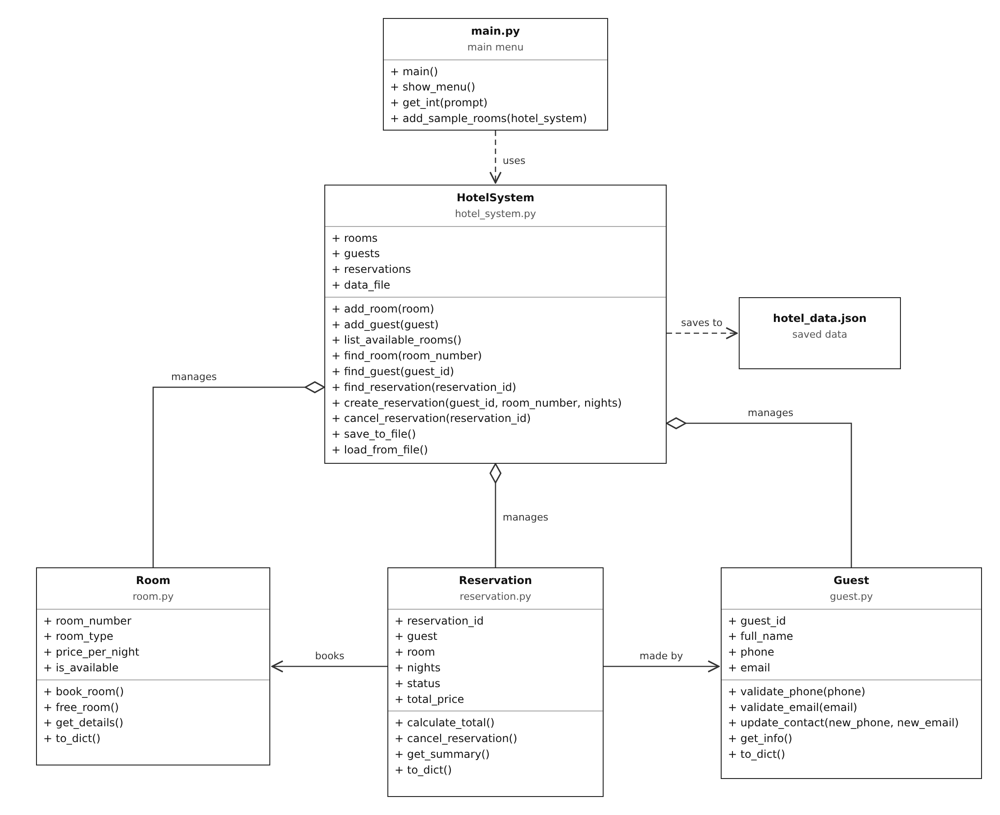

# Hotel Reservation System

## About the Project

This is a simple hotel reservation system I made for my B100 programming course at GISMA. I write it in Python.

With this program, you can check available rooms, add guests, make reservations and cancel them. It runs in the terminal and uses a JSON file to save the data.

## Why I Made This Project

I wanted to practise Python by making something based on a real-life example. While working on this project, I used classes and objects and learned more about how to save and load data with JSON files.

## Requirements

-Python 3.9 or newer    
-No additional libraries are needed.

## How to Run

1. Clone the repository:

   ```bash
   git clone https://github.com/Cato361/hotel_reservation_system.git
   ```

2. Open the project folder:

   ```bash
   cd hotel_reservation_system
   ```

3. Run the program:

   ```bash
   python3 main.py
   ```

## What Can You Do?

See which rooms are available
Add new guests
Make a reservation
See all reservations
Cancel a reservation
Save data and load it again when the program starts

The program also checks some basic things, for example, it doesn't allow you to book a room that is already reserved or create a reservation for less than one night.


## Example Usage

===== HOTEL RESERVATION MENU =====  
1 - List available rooms    
2 - Add a new guest     
3 - Create a reservation    
4 - List all reservations   
5 - Cancel a reservation    
6 - Save and exit   
Your choice: 2  
Full name: Jo professor 
Phone: +49 1721728219   
Email: jotheprofesor@gmail.com  
Guest added with ID 2.  

===== HOTEL RESERVATION MENU =====  
1 - List available rooms    
2 - Add a new guest     
3 - Create a reservation    
4 - List all reservations   
5 - Cancel a reservation    
6 - Save and exit   
Your choice: 3  
Guest ID: 2 
Room number: 1  
Number of nights: 4 
Reservation created: Reservation 2 | Jo professor | Room 1 | 4 nights | 320.0 EUR | active      

===== HOTEL RESERVATION MENU =====  
1 - List available rooms                
2 - Add a new guest     
3 - Create a reservation        
4 - List all reservations   
5 - Cancel a reservation    
6 - Save and exit   
Your choice: 1  
2: double|100.0 not booked  
3: double|100.0 not booked   

## Project Files

| File            | Description |
|-----------------|---|
| main.py         | Main menu and user input |
| hotel_system.py | Handles the hotel system |
| room.py         | Room class |
| guest.py        | Guest class |
| reservation.py  | Reservation class |
| hotel_data.json | Stores the saved data |

## Class Diagram



## Author

Cagatay Kocak

B100C – Introduction to Computer Programming with Python  
GISMA University of Applied Sciences